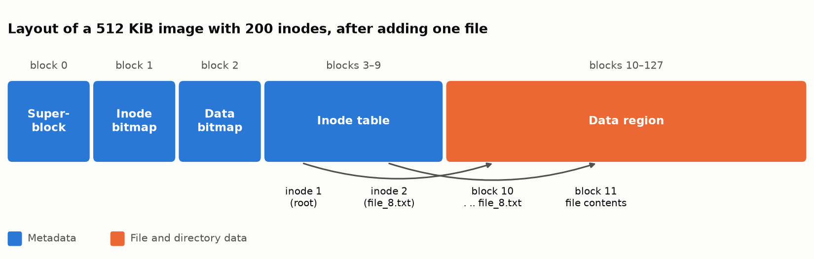

# MiniVSFS: An Inode-Based Filesystem in C


MiniVSFS is a small filesystem that lives inside a single binary disk image. Two command-line tools manage it: `mkfs_builder` formats a new image, and `mkfs_adder` copies a file into it. They handle block allocation, inodes, directory entries and on-disk checksums directly, without using the host filesystem's structure.

Built by Group 13 (Section 03) for CSE321 Operating Systems at BRAC University. The course supplied the on-disk format and CRC helpers.



## Features

- Configurable images from 180 KiB to 4 MiB, with 128 to 512 inodes and 4 KiB blocks
- Inode bitmap and data bitmap with first-fit allocation
- 128-byte inodes with 12 direct block pointers, for files up to 48 KiB
- Root directory with 64-byte entries, including `.` and `..`
- **Integrity checks at every level:** CRC32 on the superblock and on each inode, and an XOR checksum on each directory entry
- **Safe updates:** `mkfs_adder` works on a copy in memory and writes a new image only after every step succeeds, so a failed add never leaves a half-written file

## On-disk format

| Region | Blocks in the example | Contents |
|---|---|---|
| Superblock | 0 | Magic `MVFS`, region offsets, counts, CRC32 of the block |
| Inode bitmap | 1 | One bit per inode |
| Data bitmap | 2 | One bit per data block |
| Inode table | 3 to 9 | 128-byte inodes, starting at inode 1 (the root) |
| Data region | 10 to 127 | Directory entries and file contents |

## Quick start

```bash
make
./mkfs_builder --image out.img --size-kib 512 --inodes 200
./mkfs_adder --input out.img --output out2.img --file tests/fixtures/file_8.txt
python3 tests/verify_image.py out2.img --expect tests/fixtures
```

```text
Added 'file_8.txt' as inode #2 using 1 block(s). Output: out2.img
OK    1 file(s), all checksums, bitmaps and pointers consistent
```

You can see the new file in the raw bytes. The bitmaps now mark two inodes and two data blocks, the root directory has a new entry, and inode 2 points to block 11 (`0x0b`).

```text
$ xxd -g 1 -l 4 -s 4096 out2.img                  # inode bitmap
00001000: 03 00 00 00
$ xxd -g 1 -l 4 -s 8192 out2.img                  # data bitmap
00002000: 03 00 00 00
$ xxd -g 1 -l 16 -s $((10*4096+128)) out2.img     # third root directory entry
0000a080: 02 00 00 00 01 66 69 6c 65 5f 38 2e 74 78 74 00  .....file_8.txt.
$ xxd -g 1 -l 4 -s $((3*4096+128+44)) out2.img    # inode 2, first direct pointer
000030ac: 0b 00 00 00
```

On Windows, MinGW-w64 builds the same sources with `gcc`.

## Testing

`make test` runs 14 end-to-end tests. They pass on Linux (GCC, with AddressSanitizer and UndefinedBehaviorSanitizer) and on Windows (MinGW-w64).

The checks come from [`tests/verify_image.py`](tests/verify_image.py), an independent Python reader that shares no code with the C tools. It parses each image from scratch, recomputes every checksum, confirms the bitmaps agree exactly with the inodes, and compares extracted files with the originals byte for byte.

The tests cover:

- Every size and inode limit, and invalid arguments
- Files of 0, 1, 4095, 4096, 4097 and 48 KiB, and one byte over the limit
- Duplicate names and the 57-character name limit
- Corrupted superblocks and files that aren't images
- A full root directory and an image with no free blocks

Every rejected operation is also checked to leave the input unchanged and write no output.

### Bugs this process found

Writing the verifier exposed real defects in the original coursework code, all now fixed:

| Problem | Effect | Fix |
|---|---|---|
| The superblock checksum read 4,092 bytes from a 116-byte struct | Out-of-bounds read, and a wrong checksum that changed between runs | Build the superblock inside a full block buffer |
| The same name could be added twice | Duplicate directory entries | Reject duplicates before allocating anything |
| `mkfs_adder` ignored the superblock checksum | Corrupted images were accepted and re-signed as valid | Verify the checksum and region layout before use |

## Limitations

The filesystem is intentionally small: one flat root directory of up to 62 files, direct pointers only, and tools that format and add files but don't read or delete them. The `tests/verify_image.py` script can read images, and the on-disk format is unchanged from the coursework specification.

## Project layout

```text
├── src/
│   ├── minivsfs.h        On-disk structures and checksums
│   ├── mkfs_builder.c    Formats a new image
│   └── mkfs_adder.c      Adds a file to an image
├── tests/
│   ├── verify_image.py   Independent image checker
│   ├── run_tests.py      End-to-end tests
│   └── fixtures/         Sample input files
└── Makefile
```
